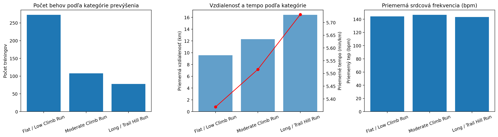

# Analýza behania a kopcovej záťaže (`Cardio Activities`)

**Krátke zhrnutie:** Dátová analýza 459 bežeckých aktivít z datasetu *Cardio Activities* podľa metodiky Google Data Analytics (*Ask, Prepare, Process, Analyze, Share, Act*). Cieľom bolo preskúmať, ako sa správa dĺžka tréningu, tempo a srdcová frekvencia pri rôznej miere prevýšenia – a prečo sa v súhrnných dátach kopcové behy ukazujú skôr ako dlhšie vytrvalostné/trailové tréningy než krátke šprinty do kopca.

---

## 1. Business task (Ask)
* **Scenár:** Tréningový bežecký program / koučingová platforma, ktorá chce lepšie pochopiť súvislosť medzi prevýšením, dĺžkou behu, tempom a srdcovou frekvenciou pri plánovaní kopcových a intenzívnych tréningov.
* **Analytická otázka:** Ako sa menia vzdialenosť, trvanie, tempo a priemerná srdcová frekvencia v závislosti od relatívneho prevýšenia na kilometer (`climb_per_km`) a prečo v agregovaných dátach prevažujú pri kopcoch dlhšie behy nad krátkymi šprintmi?
* **Sledované metriky:** `Distance (km)`, `duration_min`, `pace_min_per_km`, `Average Speed (km/h)`, `Climb (m)`, `climb_per_km` (m/km) a `Average Heart Rate (bpm)`.

## 2. Dátové zdroje (Prepare)
* **Zdroj:** Verejný dataset **Cardio Activities** (`cardioActivities.csv`) z platformy Kaggle (export kardio aktivít z Runkeeper).
* **Štruktúra a rozsah:** Po vyfiltrovaní bežeckých aktivít zostalo **459 behov** so súhrnnými hodnotami za celú aktivitu; priemerná srdcová frekvencia je dostupná pri **277 behoch**.
* **Kvalita a obmedzenia:** Dataset neobsahuje osobné identifikačné údaje. Hlavným obmedzením je, že ide o **súhrnné metriky za celý beh** (nie o samostatné krátke šprintové opakovania do kopca po metroch) a časť záznamov nemá zaznamenaný tep.

## 3. Čistenie a príprava dát (Process)
Spracovanie prebehlo v **Google Colab (Python / pandas)**:
* vyfiltrovanie záznamov typu `Running` a odstránenie prípadných duplicít (**459 behov**),
* prevod dátumov na `datetime` a časových údajov na číselné minúty (`duration_min`, `pace_min_per_km`), doplnenie chýbajúcej rýchlosti a kontrola neplatných hodnôt,
* výpočet relatívneho prevýšenia `climb_per_km = Climb (m) / Distance (km)`,
* úprava prahov kategorizácie po prvotnom teste prísneho pravidla (`<= 5,0 km` a `>= 25 m/km`, ktoré vrátilo len 3 behy) na tri prehľadné skupiny podľa reálnej distribúcie dát:
  * **Flat / Low Climb Run:** `climb_per_km < 10`
  * **Moderate Climb Run:** `10 <= climb_per_km < 15`
  * **Long / Trail Hill Run:** `climb_per_km >= 15`

## 4. Zhrnutie analýzy (Analyze)
Celý súbor 459 behov má priemernú vzdialenosť **11,38 km** (medián **10,81 km**), priemerný čas **62,22 min**, priemerné tempo **5,46 min/km**, priemerné prevýšenie **124,79 m** a priemerné `climb_per_km` **9,96 m/km** (maximum **46,50 m/km**). Celkový priemerný tep je **144,99 bpm**.

| Kategória behu | Počet behov | Podiel | Priem. vzdialenosť | Priem. trvanie | Priem. tempo | Priem. prevýšenie | Priem. `m/km` | Priem. tep |
| :--- | :---: | :---: | :---: | :---: | :---: | :---: | :---: | :---: |
| **Flat / Low Climb Run** | 273 | 59,5 % | 9,58 km | 50,83 min | 5,37 min/km | 65,92 m | 6,71 m/km | 144,36 bpm |
| **Moderate Climb Run** | 108 | 23,5 % | 12,29 km | 67,70 min | 5,52 min/km | 159,94 m | 12,91 m/km | 146,80 bpm |
| **Long / Trail Hill Run** | 78 | 17,0 % | 16,44 km | 94,52 min | 5,73 min/km | 282,17 m | 17,21 m/km | 143,50 bpm |

## 5. Vizualizácie a kľúčové zistenia (Share)
* **Rozloženie tréningov:** Takmer 60 % behov spadá pod rovinaté/nízkokopcovité behy, no **40,5 % (186 behov)** tvorí stredne alebo dlho kopcovitú záťaž.
* **Vzdialenosť vs. tempo:** S vyšším relatívnym prevýšením rastie priemerná dĺžka behu (z **9,58 km** na **16,44 km**) a tempo sa spomaľuje (z **5,37 min/km** na **5,73 min/km**).
* **Srdcová frekvencia:** Najvyšší priemerný tep má kategória **Moderate Climb Run** (**146,80 bpm**), zatiaľ čo pri **Long / Trail Hill Run** klesá na **143,50 bpm** – pravdepodobne pre opatrnejšie tempo alebo technickejší terén pri dlhších behoch.

## 6. Ďalšie výstupy (Act – rozvoj analýzy)
* Rozbor jednotlivých úsekov a sklonov z priložených **GPX súborov** na presnejšie zachytenie krátkych šprintov alebo strmých pasáží.
* Analýza vývoja v čase (ročné/mesačné trendy, sezónnosť).
* Porovnanie tréningov s meraným tepom a bez neho, prípadne doplnenie dát o regenerácii.

## 7. Hlavné zhrnutie a odporúčania (Act)
* **Hlavný záver:** V tomto datasete kopcové behy predstavujú predovšetkým **dlhšie vytrvalostné a trailové tréningy**, nie krátke šprinty do kopca, pričom najvyšší priemerný tep sa objavuje pri stredne kopcovitých behoch.
* **Odporúčanie:** Dlhé kopcovité behy využívať na vytrvalosť a silu v kopcoch pri kontrolovanom tempe, stredné kopce na cielenú intenzitu a ak je cieľom tréning krátkych kopcových šprintov, merať a vyhodnocovať konkrétne krátke intervaly namiesto celkového priemeru behu.
